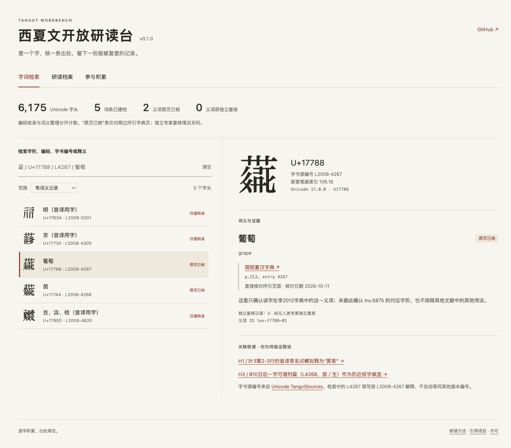

# Tangut Workbench · 西夏文开放研读台

[](https://github.com/ZJUZhiyuCai/tangut-workbench/actions/workflows/checks.yml)
[](LICENSE)
[](licenses/CC-BY-4.0.txt)

**逐字积累有出处的词义，逐段推进能被复查的翻译。**

An open, source-linked workspace for Tangut lexicography and manuscript research.
Character encoding, dictionary senses, manuscript readings, and hypotheses are recorded separately.

**[在线检索与研读](https://zjuzhiyucai.github.io/tangut-workbench/)** · [研究案例](docs/research/inv5875.md) · [贡献指南](CONTRIBUTING.md) · [路线图](docs/ROADMAP.md) · [下载版本](https://github.com/ZJUZhiyuCai/tangut-workbench/releases)

## 我们正在做什么

从《太宗择要文》Inv.5875 的校读出发，逐步建立可追溯的西夏文字典与文献译注库。每个义项要能找到来源，每个拟释要说明未决问题，每次修订要留下记录。尚不能认出的字、没有取得的图像和互相冲突的解释，都可以如实保存。

西夏文已有深厚的释读传统。本项目是在前人研究基础上继续核对、整理和提出可检验的问题，不声称重新破解整个文字系统。初始数据和程序由 AI 辅助整理，语言学判断尚无人类专家独立复核。

## 首版包含什么

以下是 **v0.1.0** 的固定快照；实时统计由数据自动生成，运行 `tangut stats` 查看。

| 类别 | 数量 | 含义 |
| --- | ---: | --- |
| Unicode 字头 | 6,175 | Unicode 17 官方编码及字书源编号索引，**不是 6,175 条已释词义** |
| 已建档词条 | 5 | 字头与义项分开保存，可继续增加多字词与一词多义 |
| 原页已核义项 | 2 | 𗞈“葡萄”、𗞤“苗”，均指李范文2012年字典页513 |
| 仅据转录义项 | 3 | 保留网页出处，尚待字典原页复核 |
| 独立复核义项 | 0 | “原页已核”不等于通过专家复核 |
| 文献研究 | 1 | Inv.5875《太宗择要文》 |
| 待验证假说／未释区域 | 4／4 | 均保留限制条件；没有自动升级为译文 |
| 既刊字序定位窗口 | 6 | B14 段末的图文定位，不计为新增释字 |
| 新增完整段落译文 | 0 | 全文翻译仍在推进 |

网站支持字形、`U+17788`、`L4267`（按 `L2008-4267` 解释）、中英文释义检索，显示出处、审核状态和关联假说。随附字体暂缺的30个新编码字头显示码位提示，仍可检索。



## 本地运行

需要 Python 3.11 或更新版本；运行时不调用模型、不需要 API 密钥。

```bash
git clone https://github.com/ZJUZhiyuCai/tangut-workbench.git
cd tangut-workbench
python3 -m venv .venv
source .venv/bin/activate  # Windows: .venv\Scripts\activate
python -m pip install -e ".[dev,cldf]"
tangut validate
python -m unittest discover -s tests -v
tangut lookup 葡萄
tangut lookup U+177A4
tangut stats
tangut build --output build/site
python -m http.server 8000 --directory build/site
```

打开 `http://localhost:8000`。请通过 HTTP 预览，直接双击 HTML 会受到浏览器本地文件读取限制。CLI 默认在仓库根目录运行；在其他位置可用 `tangut --root /path/to/repository stats`。Python 安装只安装工具，数据保留在仓库中。

```bash
# 从固定版本官方文件重建索引（没有网络请求）
tangut import-unicode

# 导出并用 pycldf 验证 CLDF Dictionary
tangut export-cldf --output build/cldf

# 生成可重复构建的数据包、CLDF 包及 SHA256 清单
python scripts/release.py
```

CLDF 导出目前只包含原页已核的2个义项；保留证据状态和独立复核数量。候选释义、仅据转录义项、Unicode 空字头和校读假说不混入该导出。[格式说明](docs/DATA_MODEL.md)

## 项目结构

```text
data/                   字头、词条、义项、来源、写本、定位、未释区与假说
schemas/                JSON Schema
src/tangut_workbench/    导入、校验、检索、统计、网页和 CLDF 导出
web/                    无框架静态检索界面与开放字体
docs/research/          可持续修订的研究记录
tests/                  数据约束、检索、导出与边界测试
vendor/                 Unicode 固定源文件与第三方资产 SHA256 清单
licenses/               数据、字体及 Unicode 许可
.github/                持续集成、Pages 发布、贡献表单
```

未释不强补，候选不自动采纳。校验器检查结构、引用、坐标、许可字段和状态约束；它不能判断语言学推论是否正确。研究结论仍需逐条审阅。[方法与质量标准](docs/METHOD.md)

首版已执行28项 Python 测试和25项浏览器交互检查。[验证范围与复现方法](docs/VALIDATION.md)

## 与已有工作的关系

- [Unicode TangutSources](https://www.unicode.org/Public/17.0.0/ucd/TangutSources.txt) 是编码与字书源编号的基础。
- [Open Tangut](https://github.com/imlooh/open-tangut) 已做出多语词典数据聚合。本项目侧重逐条证据和文献语境；当前没有复制其聚合词典或 OCR 词表。
- [古今文字集成](http://ccamc.co/tangut.php) 是重要的检索入口。网页转录与字典原页核对分别记录。
- [CLDF Dictionary](https://github.com/cldf/cldf/tree/master/modules/Dictionary) 与 [Dictionaria](https://dictionaria.clld.org/) 提供可互操作词典的实践参照。项目采用字头／义项分表并提供实际经 pycldf 校验的导出；这不代表上述项目认可或收录了本项目。
- 文献释读始终标注聂鸿音等研究者的既有成果。[Inv.5875 来源与边界](docs/research/inv5875.md)

## 参与和许可

一条带原页出处的纠正就有价值。第一次贡献可从 [近期任务](docs/ROADMAP.md) 选择一个小问题，通过 [Issue](https://github.com/ZJUZhiyuCai/tangut-workbench/issues/new/choose) 或 Pull Request 提交。维护者不会把程序通过校验当成学术认可。

代码：**MIT**。项目原创注释和文档：**CC BY 4.0**。Unicode 数据与 Noto 字体各保留原许可；古籍、现代字典、扫描图和外部网站不因被引用而获得本项目的再授权。仓库不分发权属未明确的整本词典、现代论文或写本扫描图。[完整说明](NOTICE.md)

引用时请注明具体版本或提交号，并一并引用你使用的具体义项所列的原始文献。项目引用信息见 [CITATION.cff](CITATION.cff)。
