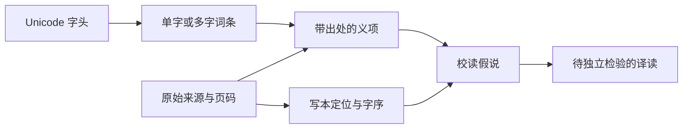

# 研读方法与质量标准

## 几种对象必须分开

一个 Unicode 字头不等于一个词；一个词可能有多个义项；字典义项不保证在某处手稿中适用；典故相似也不等于已经认出了写本字形。项目分别保存这些对象，并用稳定 ID 和出处连接。

## 从来源到译文

先取得合法可访问的原始材料并登记版本。对写本，先定位到叶、栏与图像坐标，区分纸损、墨迹存留但未识、重文符号和编辑展开。用已认字建立同书手的比较样本，再查字书、语法与平行文献。异书手字例可以提示方向，不能代替目标手稿的笔画证据。

记录直接观察，另列推论和竞争读法。释读有冲突时保留原基线，注明候选；文字确认和语义解释可以处在不同阶段。遇到原页未取得、缺失叶或版本关系未明时，准确标注缺口。

编码、转录、翻译和解读都可能修订。不能因为“没检索到译文”就声称首次发现，不能因为模型生成了通顺句子就认为译通。拟音必须标注学者和体系，本版尚未建立拟音数据层，不把不同体系混在同一字段中。

## 状态的含义

| 对象 | 状态 | 只说明什么 |
| --- | --- | --- |
| 义项 | `source_reported` | 本项目只有转录或转引层面的证据 |
| 义项 | `source_checked` | 本项目已直接对照所引字典页；不是同行评议或新发现 |
| 义项 | `proposed` | 正在检验的释义，尚不能纳入保守词典导出 |
| 假说 | `proposed` | 未采纳；记录支持理由及未决问题 |
| 假说 | `rejected` / `withdrawn` | 保留被否定或撤回的记录与原因 |
| 字序 | `published_transcription` | 继承前人已刊转录，必须署明来源 |
| 字序 | `proposed` / `adopted` | 项目候选或经审阅采纳的转录；采纳仍可被后续证据修订 |
| 译文 | `untranslated` / `proposed` / `translated` | 未译、拟译、已形成可审阅译文；不自动代表外部专家认可 |

独立复核使用单独的署名记录，不由状态、OCR 分数、模型自检或 CI 结果替代。初版所有义项的独立复核数为0。

## 进度计数

`tangut stats` 从数据即时计算。编码字头数、词条数、各状态义项数、独立复核数量、定位窗口、未释区和新增完整段落分开报告。

连续段落必须用 `unit_type: passage` 建档；`alignment_window` 不可标为新译段。已刊字序重新编码或对齐，不能增加新译段数。即使构造满足格式的记录，是否真正连续、准确和具有新意仍需文献审阅，校验器无法代替这一判断。

## 发布前

执行结构、引用、坐标、第三方文件校验和相关测试；检查来源署名和权利；核对界面显示与数据一致；发布带版本号和 SHA256 的数据快照。发现错误时追加修订，不抹去来源和讨论历史。仅在某个具体问题需要时扩展数据结构，避免用复杂流程替代实际校读。
